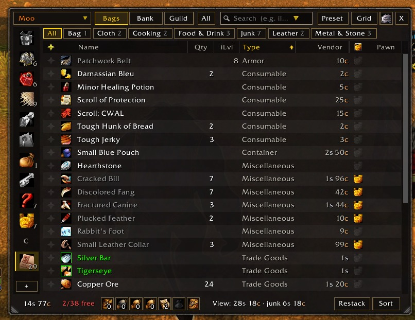
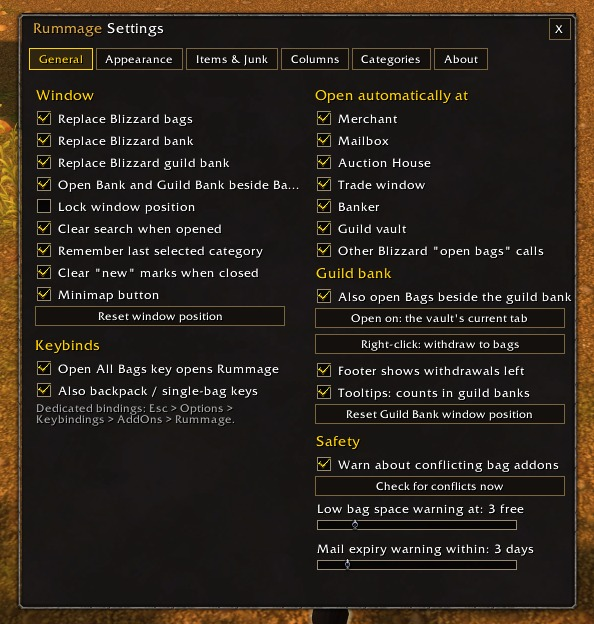

# Rummage

## TL;DR

**A simple way to manage your bags in WoW Forever** — by Malikor.
Find things fast, see what items are worth, keep up with your other
characters, and sell unwanted items with one click.

## Features

- Browse your bags, bank, and guild storage from one place.
- Find items by name or words you remember.
- Choose a clear list or picture view; sort items your way.
- Make your own groups and arrange them as you like.
- Check what your other characters have.
- See what an item is worth, how strong it is, and when you found it.
- Mark favorites and unwanted items; sell unwanted items quickly.
- Move items between bags and storage, combine matching piles, or empty a bag.
- Spot new finds and gear that may be better.
- Call a random pet or favorite mount.
- Use a controller: move through items, use them and mark them with the gamepad.

## Screenshots

<table>
<tr><th>List view — icon rail</th><th>List view — category filters</th></tr>
<tr>
<td></td>
<td></td>
</tr>
<tr><th>Grid view</th><th>General settings</th></tr>
<tr>
<td></td>
<td></td>
</tr>
</table>

## Layout

| Path | What it is |
| --- | --- |
| `Rummage/` | The addon: Lua sources, `Rummage.toc`, `Media/`, plus its README, FEATURES, DESCRIPTION and CHANGELOG |
| `screenshots/` | README gallery images, kept outside the addon package |

The player guide is in [Rummage/README.md](Rummage/README.md); the
full feature list is in [Rummage/FEATURES.md](Rummage/FEATURES.md);
what changed is in [Rummage/CHANGELOG.md](Rummage/CHANGELOG.md).

## Install

Extract the `Rummage` folder into
`World of Warcraft\_classic_beta_\Interface\AddOns\` and `/reload`.

## License

Copyright © 2026 Malikor. Released under the GNU General Public
License v3.0 or later — see `LICENSE`.
