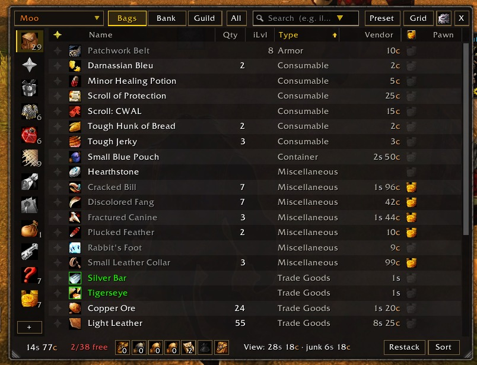
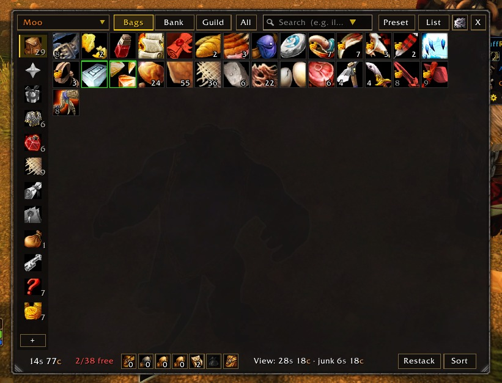

# Rummage

## TL;DR

**List-view bag & bank replacement for WoW Forever** — by Malikor.
Every item you own in one sortable table: full names, item level,
vendor and auction values, Pawn upgrades. Search with a real query
language, browse any character's bags and bank from anywhere, and
sell junk in one click.

## Screenshots

<table>
<tr><th>List view — icon rail</th><th>List view — category filters</th></tr>
<tr>
<td></td>
<td></td>
</tr>
<tr><th>Grid view</th><th>General settings</th></tr>
<tr>
<td></td>
<td></td>
</tr>
</table>

## Layout

| Path | What it is |
| --- | --- |
| `Rummage/` | The addon: Lua sources, `Rummage.toc`, `Media/`, plus its README, FEATURES, DESCRIPTION and CHANGELOG |
| `screenshots/` | README gallery images, kept outside the addon package |

The player guide is in [Rummage/README.md](Rummage/README.md); the
full feature list is in [Rummage/FEATURES.md](Rummage/FEATURES.md);
what changed is in [Rummage/CHANGELOG.md](Rummage/CHANGELOG.md).

## Install

Extract the `Rummage` folder into
`World of Warcraft\_classic_beta_\Interface\AddOns\` and `/reload`.

## License

Copyright © 2026 Malikor. Released under the GNU General Public
License v3.0 or later — see `LICENSE`.
