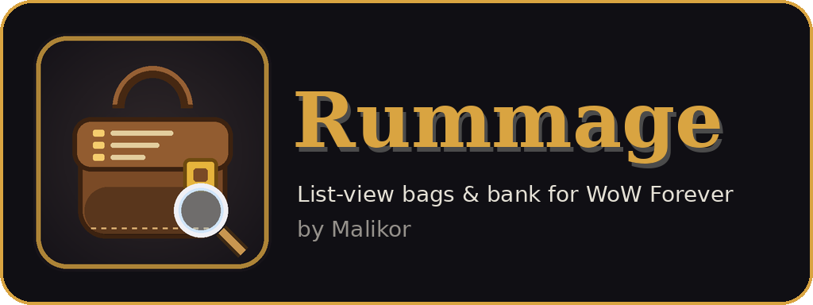

# Rummage

**List-view bag & bank replacement for WoW Forever** — by Malikor

Rummage puts every item you own into one sortable table: full item names, item level, required level, type, vendor value, auction prices, Pawn upgrades and more. Filter by category in one click, search with a real query language, browse any character's bags and bank from anywhere, and sell junk in one click. It combines the feature sets of Sorted and all of its plugins (Scrap, Auctionator, TradeSkillMaster, Pawn, Pawn Reloaded, Can I Mog It?) in a single addon, plus Baganator/Syndicator-style cross-character tracking.

**Docs:** [Features](FEATURES.md) · [Description](DESCRIPTION.md) · [Changelog](CHANGELOG.md)

## Features

**Window**
- One window for bags, keyring and bank, with Bags / Bank tabs
- **List view** (configurable table) or **grid view** (icons with item level, count, favorite, junk, upgrade and quest badges)
- Sort by any column; favorites and/or new items pinned on top
- Show, hide, reorder and resize columns (drag a header edge; right-click a header to toggle)
- Group by category, type, quality or bag, with collapsible group headers
- Combine identical stacks into one row
- Movable, resizable, scalable, lockable; opacity control

**Finding things**
- Category sidebar: All, Favorites, New, Equipment, Consumables, Trade Goods, Recipes, Quest Items, Bags & Ammo, Keys, Miscellaneous, Junk — with live counts
- Sub-filter chips per category (e.g. Cloth / Leather / Herb)
- **Custom categories** built from search queries (sidebar "+", or the Categories settings tab)
- Click a bag icon to show only that bag
- Optionally remembers the last selected category, even across sessions
- The search box remembers your **last 10 searches** (arrow button at its right end)
- **Search all characters:** the "All" button beside the tabs (or the setting) makes searches run across every character's cached bags and bank, with an optional Owner column. Results are view-only in this mode.
- **Sort presets:** the Preset button saves named combinations of sort, grouping and view settings
- The footer shows the **vendor value of the current view** (with the junk portion broken out)
- Search syntax (combine freely):

| Example | Meaning |
|---|---|
| `linen` | name, type, subtype or slot contains "linen" |
| `ilvl>20`, `ilvl:10-20`, `lvl<=30` | item level / required level |
| `q:rare`, `q>=uncommon` | quality (poor, common, uncommon, rare, epic, legendary) |
| `type:armor`, `sub:cloth`, `slot:head` | item type / subtype / equip slot |
| `count>5`, `bag:2` | stack size / bag number |
| `value>1g`, `ah>50s`, `tsm>2g`, `pawn>5` | vendor, Auctionator, TSM value; Pawn upgrade % |
| `#fav #new #junk #upgrade #boe #bop #bound #gear #consumable #quest #trade #recipe #key #usable` | keywords |
| `a b` / `a & b` | AND |
| `a \| b` | OR |
| `!term` | NOT |

**Items**
- Favorites with 8 raid-marker icons (click the star column, or Alt+click an item)
- New-item highlighting and "time since acquired" column
- Required-level tint for gear you can't use yet; quest-starter badges
- Cooldown swipes and locked-item dimming

**Upgrade popup**
- When you loot or receive gear that's an upgrade, a small, movable popup appears with a one-click **Equip** button
- Pawn decides when installed; otherwise item level for your armor type (dual-wield and two-handers handled)
- Gear you can't use is skipped; rings/trinkets go into your weaker slot
- Clicking during combat equips as soon as combat ends
- Auto-hides after a configurable time (pauses while hovered); right-click the X to never suggest that item again

**Characters & bank**
- Cached bags, bank, equipped items, mailbox and gold for every character
- Browse any character from the name button; forget old characters from there
- Gold tooltip with every character and the account total
- Item tooltips show counts on all characters (bags / bank / equipped / mail), Syndicator-style
- Supports both classic bank bags (with slot purchase) and modern bank tabs

**Junk, merchants, moving items**
- Grey items are junk by default; mark/unmark anything (coin column or Alt+right-click)
- **Auto-junk rules:** up to 8 search queries — anything matching counts as junk (Items & Junk settings). Favorites are never junk by rule; manual marks always win.
- One-click **Sell Junk** or auto-sell; favorites are never sold; optional buyback-safe mode (max 12)
- Auto-repair (guild funds first, if available)
- **Restack** partial stacks; Blizzard sort when the client provides it
- **Transfer**: moves everything currently listed (after search/filters) bags ⇄ bank
- **Empty a bag**: right-click its icon
- Drop the cursor item onto empty list space to put it in a free slot
- Low-bag-space warning

**Blizzard integration**
- Replaces the Blizzard bags (incl. one-bag mode) and bank window
- Your **Open All Bags** keybind (and optionally Backpack / Bag 1-5 keys) opens Rummage — done with override bindings, so your saved keybinds are never changed
- Dedicated keybinds under Keybindings › AddOns › Rummage: toggle bags, toggle bank, focus search
- Per-context auto-open: merchant, mailbox, auction house, trade, bank
- Minimap button (LibDBIcon if present), LibDataBroker launcher, and an addon-compartment entry

**Profiles & sharing**
- Save your whole setup as named **profiles** (General settings); optionally per-character, so each character re-applies its profile at login
- **Export / import** the whole setup (settings, columns, custom categories, auto-junk rules) as one text string — About tab in settings, or `/rum export` / `/rum import`

**Conflict protection**
- On login Rummage detects other bag addons (Baganator, Bagnon, ArkInventory, AdiBags, BetterBags, Combuctor, Sorted, LiteBag, cargBags, Inventorian, BagMom, Bagforge, OneWoW Bags, BaudBag, ClassicUI Bags …) and the ElvUI / NDui bag modules, warns in chat, and offers **Disable & Reload**. Syndicator and BagSync are not bag replacements and are left alone.

## Themes

| Theme | Look |
|---|---|
| **Forever (Blizzard)** *(default)* | Uses the client's own modern Blizzard frame border and stone background, gold accents — matches the WoW Forever UI |
| **ElvUI** | Flat pixel borders; reads ElvUI's live backdrop/border/value colors and font when ElvUI is loaded |
| **EllesmereUI** | Dark translucent glass panels with hairline borders |
| **GW2 UI** | Warm dark panels with gold accents |
| **Tukui** | Flat grey with class-colored accent |
| **NDui** | Translucent black with class-colored accent |
| Minimal Dark, Parchment, Classic Tooltip | Extras |

**Auto** (default setting) picks the matching theme when one of those UI suites is installed, otherwise Forever. Fonts: theme default, built-in WoW fonts, or any LibSharedMedia font. Optional class-colored accent.

## Integrations (all optional, auto-detected)

| Addon | What you get |
|---|---|
| Auctionator | Auction price and disenchant value columns, `ah>` search |
| TradeSkillMaster | Price column for any custom price source (default `DBMarket`), `tsm>` search |
| Pawn | Upgrade arrow and upgrade % column (Sorted-Pawn + Pawn Reloaded), `#upgrade` / `pawn>` search |
| Can I Mog It? | Transmog status column (if the client has transmog) |
| Scrap | Uses Scrap's junk list for marking and selling |
| Syndicator | Rummage's tooltip counts step aside (toggle in settings) |

## Commands

`/rum` toggle bags · `/rum bank` · `/rum search <text>` · `/rum config` · `/rum restack` · `/rum sell` · `/rum conflicts` · `/rum keys` · `/rum upgrade` (preview popup) · `/rum export` · `/rum import <string>` · `/rum reset`

Diagnostics: `/fdebug` (or `/rum debug`) toggles an overlay with memory, frame time, event rates and timings · `/fdebug report` · `/fdebug reset`. See `AUDIT.md` for the performance report.

## Mouse

- Left/right-click, drag, Shift/Ctrl-click items exactly like Blizzard bags
- Alt+click: cycle favorite · Alt+right-click: toggle junk
- Bag icons: click = filter, right-click = empty, drag a bag onto a slot to equip it

## Install

Extract the `Rummage` folder into
`World of Warcraft\_classic_beta_\Interface\AddOns\` and `/reload`.

## Notes

- Item list changes that happen while in combat are applied as soon as combat ends.
- Guild bank and equipment sets are not shown (WoW Forever has neither).
- EllesmereUI's own Bags module can't be detected automatically; if you enable it, disable one of the two.

## License

Copyright © 2026 Malikor. Released under the GNU General Public License v3.0 or later — see `LICENSE`.
